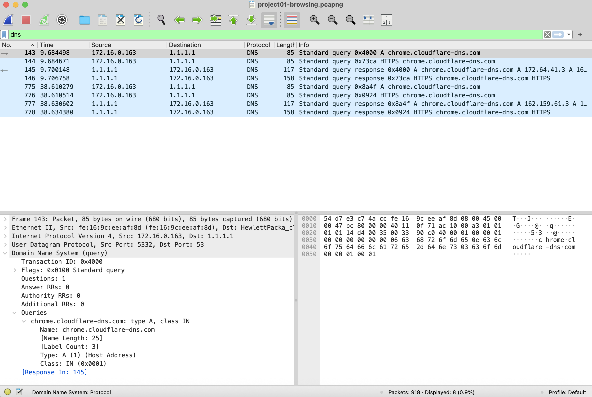
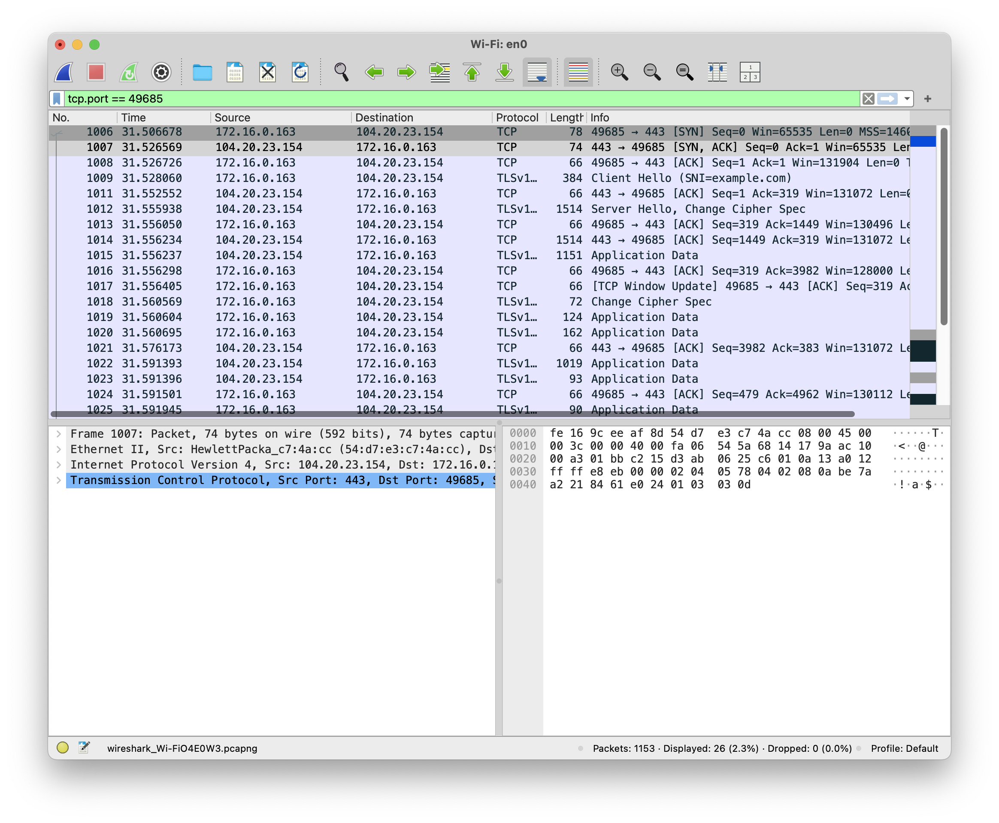
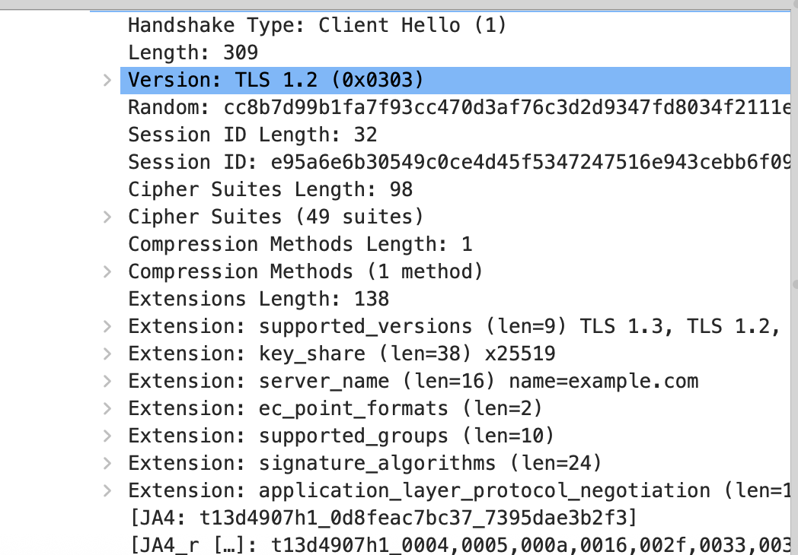
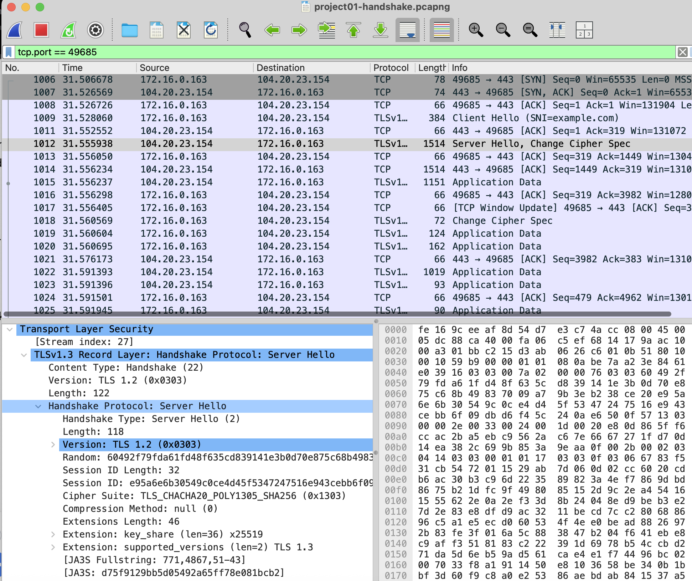
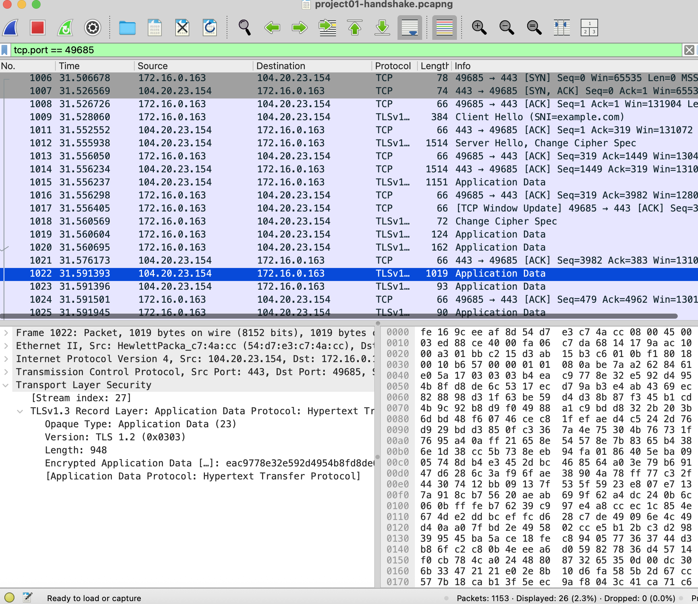

# Project 01: Network Traffic Analysis with Wireshark

## Objective
Capture traffic from my own Mac and investigate DNS, TCP connection establishment, and TLS encryption during an HTTPS request.

## Tools and Environment
- macOS
- Wireshark 4.6.9
- Wi-Fi interface: en0
- Terminal and curl
- Test website: https://example.com

## Procedure
1. Captured a short browsing session on my Wi-Fi interface.
2. Saved the capture as project01-browsing.pcapng.
3. Used the dns filter to examine queries and responses.
4. Found no TCP SYN packets in the initial capture.
5. Started a second capture and generated a fresh request using:
   `curl --http1.1 https://example.com`
6. Saved it as project01-handshake.pcapng.
7. Located SYN packets with `tcp.flags.syn == 1`.
8. Isolated the connection with `tcp.port == 49685`.
9. Examined the TCP handshake, TLS negotiation, and encrypted data.

## Finding 1: DNS Queries and Responses
The first capture contained 918 packets, including eight packets matching the dns display filter.

My Mac at 172.16.0.163 queried 1.1.1.1 for chrome.cloudflare-dns.com. Packet 143 was an A-record query, and packet 145 was its matching response. The query used UDP destination port 53.

These DNS packets were for chrome.cloudflare-dns.com. They do not demonstrate a DNS lookup for example.com.

## Finding 2: TCP Three-Way Handshake
The second capture showed a connection between my Mac at 172.16.0.163:49685 and the server at 104.20.23.154:443.

| Packet | Direction | Flag |
|---|---|---|
| 1006 | Client to server | SYN |
| 1007 | Server to client | SYN-ACK |
| 1008 | Client to server | ACK |

These three packets established the TCP connection before TLS negotiation began.

## Finding 3: TLS Negotiation
Packet 1009 contained a TLS Client Hello with the server name example.com. The client offered 49 cipher suites and supported versions including TLS 1.3 and TLS 1.2.

Packet 1012 contained the Server Hello. Its supported_versions extension selected TLS 1.3, and its selected cipher suite was TLS_CHACHA20_POLY1305_SHA256.

I learned that the legacy TLS 1.2 version field alone does not identify the negotiated version of a TLS 1.3 connection.

## Finding 4: Encrypted Application Data
Packet 1022 traveled from the server to my Mac and contained TLS 1.3 encrypted application data.

I could observe IP addresses, ports, packet sizes, and timing, but could not read the HTTP contents in this capture.

## Troubleshooting
The initial capture showed existing connections but no SYN packets. Those connections may have begun before capture started.

Starting a new capture and making a fresh curl request allowed me to record a complete TCP handshake.

## What I Learned
- How to capture traffic and apply display filters.
- How to match a DNS query with its response.
- How to identify SYN, SYN-ACK, and ACK.
- How TCP connection setup differs from TLS negotiation.
- How to confirm the selected TLS version.
- What information remains visible when application contents are encrypted.

## Scope and Limitations
This was a learning exercise using traffic from my own computer. It was not a malware investigation, and encryption alone does not establish that traffic is safe.

The raw packet captures are stored locally and are not included in this public repository.
